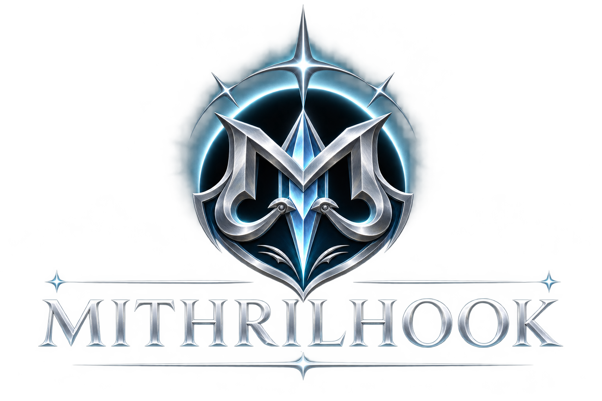

# MithrilHook

<p align="center">
  
</p>

**Distribution license: [GPL-3.0-only](LICENSE).** Original third-party notices
are retained separately; they are not alternative licenses for the complete fork.

**Version: 1.0.3.** The canonical version is in [VERSION](VERSION).
CMake, installed packages and DLL resources use 1.0.3 without a prerelease
suffix or prerelease opt-in. See [Release preparation](docs/RELEASE.md).

MithrilHook is an independently maintained Windows x86/x64 function-hooking
library derived from MinHook. It has its own **MTH_*** API, build targets,
package identity and version history. There is no legacy API alias header.

The library integrates strict peer preparation,
retryable patch completion, generated-code retirement checks and checked
instruction relocation. **It is not a production acceptance or universal
unload-safety guarantee.** See [Safety](docs/SAFETY.md) and the exact results in
[Validation](docs/VALIDATION.md).

The 1.0.3 source combines [PR #21](https://github.com/raleonys/mithrilhook/pull/21)'s
undefined-trap refusal with [PR #22](https://github.com/raleonys/mithrilhook/pull/22)'s
occupied-slot retirement correction, plus [PR #23](https://github.com/raleonys/mithrilhook/pull/23)'s
complete byte-window stack-owner scan. Publication is paused by the owner;
setting VERSION does not create a tag or release. Completed validation and performance
records identify their exact sources. See [Validation](docs/VALIDATION.md),
[Benchmarks](docs/BENCHMARKS.md) and [Remaining work](docs/REMAINING_WORK.md).

## What is included

- Owned duplicated peer handles, strict suspend/context checks, and retryable
  resume/handle/backing-array cleanup with both emergency ownership slots.
- Correct enable/disable IP mapping and cleanup barriers on public mutations.
- A completion journal for instruction-cache flush and each page's protection;
  physically written hook state remains recorded if completion fails.
- Trampoline/relay flush before publication; conservative IP/register/stack
  checks before retiring generated code; retryable buffer and heap release.
- Checked RIP-relative relocation, EIP wrapping, VEX classification, explicit
  rejection of unsupported relative instructions, and bounded code reads.
- Alignment-safe decoder/displacement access and same-thread reentry refusal.
- Post-suspension peer coverage checks and retryable IP reconciliation against
  actual writes after failed preparation or partial batches.
- Owned x64 runtime-function metadata for supported version-1 prologues and
  stack/frame-neutral body prefixes, with retryable registry/storage retirement.
  Unknown formats and untranslated handler-bearing bodies remain refused.
  See [Unwind support](docs/UNWIND.md) and [Security audit](docs/SECURITY_AUDIT.md).

Strict behavior is compiled directly into the core. There is no best-effort
mode or opt-out from the ownership checks. No application repository, source
patch script, third-party NT-header package, or external decoder package is
required to build MithrilHook.

## Build

Windows requires an x86/x64 C compiler and Windows SDK. CMake 3.20 or newer is
the supported build entry. Production sources use C17; native tests also need
C++17 and Python 3.9+. Compiler-provided CRT support is used normally.

```powershell
cmake -S . -B build/native -A x64 -DBUILD_TESTING=ON
cmake --build build/native --config Debug
ctest --test-dir build/native -C Debug --output-on-failure
cmake --build build/native --config Release
ctest --test-dir build/native -C Release --output-on-failure
cmake --install build/native --config Release --prefix dist/install
```

Use `-A Win32` for x86. Set `-DBUILD_SHARED_LIBS=ON` for the DLL; its product
name is MithrilHook and its exports are exclusively `MTH_*`. MSVC defaults to
`/MT` or `/MTd`; set `CMAKE_MSVC_RUNTIME_LIBRARY` explicitly when another CRT
selection is needed. The CMake target is `MithrilHook::mithrilhook` and the
installed package is `MithrilHook`.

```cmake
find_package(MithrilHook CONFIG REQUIRED)
target_link_libraries(your_target PRIVATE MithrilHook::mithrilhook)
```

## API and lifetime

Include `<MithrilHook.h>`. Initialize, create, queue activation, and apply with
`MTH_Initialize`, `MTH_CreateHook`, `MTH_QueueEnableHook` and `MTH_ApplyQueued`.
Use `MTH_StatusToString` for diagnostics. `MTH_ERROR_REENTRANT_CALL` reports an
operation recursively attempted by the same thread; the caller can inspect
`MTH_IsOperationInProgressOnThisThread` before taking its own external locks.

The original-call pointer produced by creation is a trampoline whose lifetime
is owned by the created hook. Do not free, cache beyond retirement, or call it
after successful removal/uninitialization. Disable hooks, stop future original
calls, drain existing callbacks, and then remove/uninitialize. A failed operation
can retain physical state and resources for retry; retain the same owner and
callback context. Do not run engine operations under loader lock.
See [API](docs/API.md) and [Safety](docs/SAFETY.md).

## Portable checks

Linux builds the actual x64 decoder/relocator with development-only projected
Windows memory-query boundaries. It does not execute Windows patching,
suspension, callbacks or native DLL teardown.

```sh
python3 scripts/verify_sources.py
cmake -S . -B build/portable -DCMAKE_BUILD_TYPE=Debug -DMITHRILHOOK_SANITIZERS=ON
cmake --build build/portable
UBSAN_OPTIONS=halt_on_error=1 ctest --test-dir build/portable --output-on-failure
```

The GitHub workflow provides genuine MSVC x86/x64 Debug/Release, shared x64 and Win32
builds, clang-cl x64 and portable checks. Configuration is not a test result.

## Provenance and licenses

Official source: [TsudaKageyu/minhook](https://github.com/TsudaKageyu/minhook),
commit `8af6b4acae5a9388fd742b56fa79ece89d96f823`.
Strict ownership contributions come from the pinned cyanoleon SAFE-FREEZE
candidate; relocation hardening and selected tests come from Citrine PR #363.
Exact revisions and changes are in [PROVENANCE.json](metadata/PROVENANCE.json)
and [FIXES.json](metadata/FIXES.json).

The complete MithrilHook distribution and fork additions use **GPL-3.0-only**.
The root [LICENSE](LICENSE) is the distribution license. The other two files
preserve the terms and attribution of inherited contributions:

| File | Scope |
| --- | --- |
| [LICENSE](LICENSE) | GPL-3.0-only for the combined fork and MithrilHook additions |
| [LICENSE.txt](LICENSE.txt) | Original MinHook/HDE BSD-2-Clause notices |
| [LICENSE.SAFE_FREEZE](LICENSE.SAFE_FREEZE) | Separately authorized SAFE-FREEZE BSD-2-Clause notice |

These are not three licensing choices for the complete fork. Unchanged
third-party portions retain their original grants; those grants do not extend
to the later GPL-only changes. See [THIRD_PARTY_NOTICES.txt](THIRD_PARTY_NOTICES.txt).
No existing third-party copyright or grant is removed or silently reassigned.

The approved logo, color palette and public naming are recorded in
[Branding](docs/BRANDING.md) and [BRANDING.json](metadata/BRANDING.json).
